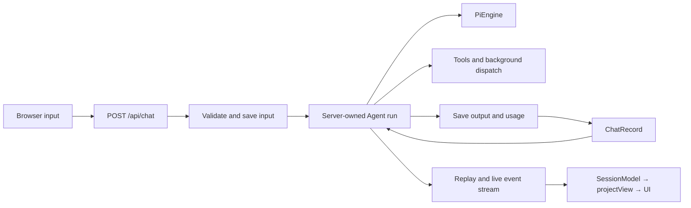
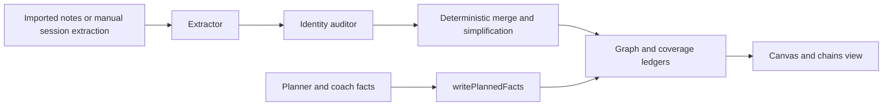

# Architecture

LearnHarness is a Next.js application with an Electron desktop host. The server owns agent runs, conversation records, background work, and filesystem persistence; the browser projects those records into a lesson/practice UI and knowledge graph.

This reference describes the [repository source](README.md#about-these-docs). See [Development](development.md) for commands and [the teaching theory](teaching-methodology.md) for pedagogical intent.

## Code boundaries

| Area | Responsibility / starting points |
| --- | --- |
| `app/` | Pages and HTTP transport; `api/chat/route.ts`, `api/chats/` |
| `components/` | Browser state and presentation; `session-core.ts`, `chat.tsx`, `graph-view.tsx` |
| `src/server/` | Composition, admission, liveness, HTTP-facing services; `chat-handler.ts`, `jobs.ts`, `stores.ts` |
| `src/agent/` | Agent construction, tools, provider streams, workers; `teacher-agent.ts`, `models.ts`, `tools.ts`, `subagents/` |
| `src/core/` | Contracts, record/view projections, domain algorithms; `input-events.ts`, `native-messages.ts`, `view.ts`, `graph.ts` |
| `src/store/` | Filesystem adapters for chats, jobs, graph, settings, and credentials |
| `electron/` | Desktop launch, navigation/permission guards, credential transport, browser helper, updater |

[`eslint.config.mjs`](../eslint.config.mjs) restricts shell imports into `src/` to the core/server barrels, prevents core imports from IO layers, and prevents agents importing server/store adapters. Dependencies arrive through injected contexts/ports. These rules are not a proof of pure core, one composition root, or one writer per store: some core modules are Node-bound and excluded from the browser barrel; server modules can import adapters. Scripts, Electron, and tests are outside these zones.

## Conversations and turns

A **conversation** is a durable `ChatRecord` with native `LhMessage[]`, settings, optional plan and probe fact list, and usage logs. Missing `kind` means teaching; `practice` selects the practitioner. An **engine** is the resolved Pi model, stream function, and thinking level. An application **turn** constructs a fresh native Pi `Agent` from saved history; it can make several model calls and execute tools. It is not an HTTP connection or a single generation.

[`chat-handler.ts`](../src/server/chat-handler.ts) resolves readiness, waits for compaction, re-reads durable truth, and claims per-chat liveness. A competing turn gets **409**. Accepted input is saved before inference; subscription automatic inputs can instead remain staged until dispatch admission. The HTTP response acknowledges admission, while `GET /api/chats/:id/stream` carries replay/live events and a terminal state.

The stored record has two projections:

- [`toLlmMessages`](../src/core/native-messages.ts) strips app metadata, flattens model-facing markers, applies the active compaction cut and, for the teacher and planner, the [fresh-context boundary](#fresh-context), and repairs eligible interrupted tool pairs at the provider boundary.
- [`projectView`](../src/core/view.ts) derives UI messages, question/problem docks, and artifacts. It is not the stored format or provider wire.

Pi seeds the system prompt/tools at construction; that synthetic system message is not persisted. New turns therefore get current instructions. The app does not use the AI SDK's client-transcript replacement or `addToolOutput` loop.

Settlement persists new native messages, plan snapshots, and usage, including partial output on abort. Failed input writes refuse inference; failed reply writes are surfaced before the terminal and do not masquerade as successful empty turns. Cleanup releases liveness. A memory-only failure notice can inform reattaching views without fabricating saved transcript content.

### Streaming and recovery

[`pi/ui-stream.ts`](../src/server/pi/ui-stream.ts) emits native agent events. Partial-message updates replace a slot; they are not accumulated text deltas. Replay retains settled events and the latest in-flight updates, with coalesced live fan-out. Tool IDs are uniquified against history so persistence, answer routing, and provider context agree.

Disconnecting a browser detaches a view, not the agent. Explicit abort is separate. [`session-core.ts`](../components/session-core.ts) owns reattachment, bounded 409 recovery, and adoption of canonical state. One recovery attachment is allowed after premature EOF/read failure; repeated transport failure shows an error.

Question drafts survive optimistic unmount in memory. Uncertain submissions reconcile the saved record and running state before resending, scoped to the same question occurrence. Provider-response retry is explicit: it preserves failed attempts on disk while omitting the eligible failed tail from temporary model context. It is not mount-time replay or automatic retry of arbitrary failures.

### Side questions

Each explanation and its associated question share one durable side conversation in teaching and practice sessions. A quiet speech-bubble entry in message history or **Ask** on selected text opens that conversation in a movable floating window, with an optional side dock ([`side-thread.tsx`](../components/side-thread.tsx), [`use-side-thread.ts`](../components/use-side-thread.ts)). Closing only hides it; saved exchanges remain reopenable. The companion never silently changes conversations as the session advances; **Go to current step →** optionally opens that step's separate history, preserving docking and per-thread drafts. Older conversations remain usable and receive the latest visible lesson on each request. Pin/Unpin switches between floating and docked presentation. Both use the theme background: opaque when docked, 50% opaque with 18px backdrop blur when floating. The input uses the main composer's opaque card surface. All four edges and all four corners resize the floating panel; opposite edges stay anchored, with the default 416px width as the preferred minimum and smaller viewports taking precedence. Chosen dimensions survive conversation switches while floating; the dock keeps its existing width. The floating panel clears only the macOS traffic-light corner, sharing the native gutter dimensions and zoom truth; ordinary browser placement is unchanged. Learner messages are right-aligned bubbles capped at 70% width; helper replies remain unboxed. The inline microphone uses the existing recorder with an explicit side-draft destination: the shortcut follows side-composer focus, a recording keeps its starting destination, and closing finishes it into that saved draft. Three compact bars sample the recorder's existing RMS signal locally while recording; they do not animate in silence or rerender the main chat. Enter on side controls stays inside the companion, including while docked. Main dictation retains its separate input claim and main submission never waits for side recording. Selected passages retain their original native message and exact-text selector as canonical citation metadata, independently of the thread's segment head. **Cite** is separate: it inserts an atomic quotation chip into the last-focused main composer or thinking field, and expands that quotation when the input is sent to the model.

A side answer is **not an application turn**. [`server/side-chat.ts`](../src/server/side-chat.ts) owns one tool-less streamed call per conversation on the session's selected model, with model/key readiness checks but no main-turn liveness, so a check, active problem, or running main turn does not block it. The helper receives a text reconstruction of the learner-visible lesson as a quoted document, not internal tool traffic or a compaction summary ([`core/side-chat.ts`](../src/core/side-chat.ts)). Open checks and active problems omit answer keys, explanations and committed solutions; question options use the learner's deterministic shuffled order. The helper receives its own thread once, separately from the lesson. Its fixed side-only brevity fragment follows the shared voice/accuracy/formatting appendix, favoring the smallest useful answer—normally one or two short sentences—rather than a mini-lesson. Closing detaches the view; Stop keeps the partial reply. Accepted usage is recorded in `turns` under the side answer's id. Changes announce on `side-chats-changed`; routes live under `app/api/chats/[id]/side-chats/`.

`ChatRecord.sideChats` holds live UI history. At main-turn start and before each subsequent internal model call, the server gathers new raw exchanges from **all** conversations, including older steps, and appends attributed custom `side-question` entries without changing earlier native history. Internal updates use the SDK's next-turn preparation hook, with normal message lifecycle events after tool results. The first call and admission-recovery calls get fresh cargo through the SDK's initial steering poll. Neither path interrupts an active call or schedules an extra teacher response. They persist with that running turn, using its existing settlement/failure contract. The pre-turn compaction trigger includes prospective side exchanges, but summarizes only already-saved history—not those new exchanges. The final SDK request hook checks the actual context after prepared references and queued steering have joined, on initial and internal calls, against the selected model's input budget (with the output reserve bounded by its maximum output; an unknown window uses the configured budget). Oversized new exchanges stay pending, with no delivery watermark: an actionable local failed response preserves the main input and completed tools for Retry or a larger model. No internal compaction, automatic extra teacher call, silent dropping, or summarization of the new exchanges occurs. A local refusal restores unadmitted automatic input without authorization recovery; its error remains visible. Its settle-time compaction kick is skipped so Retry remains available, and that Retry may cross only compaction performed by its own preflight gate—not earlier compaction or intervening input. Silent idle/parked dismissals record only the dismissal; they cannot pre-publish unchecked side exchanges into compaction history. Live replies contribute only their currently available text; a later request appends the remaining suffix and terminal status, never the already-recorded prefix. Non-prefix corrections are explicitly attributed as updated wording rather than silently replacing earlier text. The main input remains write-ahead; raw side exchanges are already durable in `sideChats`. Tentative reference entries pass final request validation and, for subscriptions, the existing dispatch admission gate. Only admitted entries publish with the running turn's settlement; refusal withdraws only unadmitted transient references, not learner steers, completed tools, earlier admitted entries, or raw history. Those immutable entries hold the delivery watermarks, which survive restart and compaction; unadmitted requests and failed saves cannot consume new exchanges. An interrupted ephemeral run is reported once if its published partial has no surviving reply. Sibling questions defer delivery until all native results are adjacent. Main requests never wait for a helper, and helper settlement never writes main-context entries on its own. Native model projection renders updates as user-role reference, not tutor replies; the shared fragment explains provenance and continuations. Updates are available to teacher/practice context and compaction, but not treated as new learner submissions by extraction or continuation logic. Chat-record version 2 separates this contract from older applications; legacy development snapshot entries remain unchanged and seed the new delivery ledger.

## Teaching and practice

[`teacher-agent.ts`](../src/agent/teacher-agent.ts) and the [tool registry](../src/agent/tools.ts) compose different agents. A teaching session runs the prober, planner and teacher over one record; practice and build sessions each run one agent:

| Agent | Interaction | Other tools |
| --- | --- | --- |
| Prober | `probe` or `recall`, `ask_user_question`, `probe_done` | Read-only files, research/PDF dispatch; gated graph readers |
| Planner | `plan_batch` | Read-only files, research dispatch |
| Teacher | `quiz` or `explain`, `ask_user_question` | Read-only files, research/PDF/demo/visual dispatch; `show_image` |
| Practitioner | `problem`, `conclude` | Read-only files, research/PDF dispatch; gated graph readers |
| Build coach | Workspace tools ([build branches](#build-branches)) | Read-only files |

Mechanic choices, settings toggles, and readiness affect availability. Practice side tools are composed separately from teaching toggles. Claude-family agents can receive `send_to_user`. Plugin contributions (for example the Coding questions plugin's `coding_question`) reach the prober, teacher and practitioner, never the planner or build coach. Argument healing precedes semantic validation; invalid calls return errors the model can correct.

Question tools validate and execute server-side, returning a synthetic terminating placeholder. It stops a clean question pose, including mixed tool batches, but is not saved. The actual learner answer becomes the call's result later. The browser shuffles options and grades select questions; free recall exposes the committed answer for model judgment. Sibling pending questions are answered without inference until the last is resolved.

Each turn, [`agentKindFor`](../src/core/native-messages.ts) selects the teaching agent from the record alone: the **prober** until a `probe_done` call has a matching successful result (a bare/refused call does not count); the **teacher** once a `node-handoff` marker exists and no `planner-wake` marker follows the latest one; the **planner** otherwise. A successful `probe_done` also queues a handoff steer that wakes the planner's first turn.

The plan is nodes made of facts. [`plan_batch`](../src/agent/tools/plan.ts) takes one to four nodes, each with one to eight facts (`id`, `name`, `statement`, optional `existing` graph id) and `requires` edges to earlier nodes, plus arrows (premises ⇒ conclusion) between facts. It validates the whole call before writing anything and lists every problem. Until the plan is accepted, each call replaces the stored tree, and the replaced plan's newly minted facts that carry no evidence leave the graph; afterwards each call appends a numbered batch (`origin: "planner"`), and existing nodes cannot change. Facts and arrows are written to the knowledge graph at plan time ([`writePlannedFacts`](../src/core/graph.ts), then layout settlement) whatever the graph settings switch says, and each stored fact keeps its graph id. The planner asks no questions; a typed reply while it is selected is an ordinary message, which its prompt treats as a change request.

A `plan-accept` input ([`input-events.ts`](../src/core/input-events.ts)) accepts the plan. It is refused unless the session is a teaching session, the planner is selected, a stored plan exists and no question is open. It appends, write-ahead, a `node-handoff` marker for the first unpassed node whose prerequisite nodes have passed, filled from the fixed START template for the plan's first handoff and CONTINUE afterwards ([`contracts/handoff.ts`](../src/core/contracts/handoff.ts)). The teacher is selected from then on.

The teacher has no plan tool. Its `quiz`/`explain` must name the current node (the latest handoff's) and one or more of that node's fact ids in `facts`; the prober's `probe`/`recall` must tag facts from the session's probe fact list once one exists. The app, not the teacher, finishes a node: after each answer the advance rule ([`plan-progress.ts`](../src/core/plan-progress.ts)) keeps the current node until all its facts pass ([evidence](#evidence-and-the-knowledge-number)), then appends a CONTINUE `node-handoff` for the next ready node, or a `planner-wake` carrying the planner brief when at most one node of the whole tree is still unpassed or no node is ready. The woken planner appends the next stretch with `plan_batch`, and the learner accepts it with another `plan-accept`.

Displayed teaching still begins at the first node-tagged `quiz`/`explain` call ([`phases.ts`](../src/core/phases.ts)), not at a handoff. Current/visited plan positions derive from tagged calls, not grades. Clients read the plan from the latest plan tool result or `plan-update` marker.

Practice uses the same turn/persistence/recovery path, not a separate problem-set service. [`tools/practice.ts`](../src/agent/tools/practice.ts) commits a statement and solution with `problem`; `conclude` records the outcome and reveals that solution. A turn-scoped gate enforces one active problem. The post-conclusion pause is doctrine, not a terminating `conclude` result. Next adds an explicit marker. Practice outcomes are session evidence, not graph mastery; they write no evidence-ledger events.

### The coach

The coach (code name `mentor`; "coach" in code already names the build coach) is a silent reviewer of learner answers in teaching sessions ([`server/mentor.ts`](../src/server/mentor.ts), [`subagents/mentor.ts`](../src/agent/subagents/mentor.ts)). It never addresses the learner.

It runs once per qualifying answer: a builtin question's or plugin teach question's answer that the request saves while the prober or teacher is selected, that is not a dismissal, and whose turn proceeds. It does not run on steers, `continue`, retries, a sibling answer that leaves another question open, or in practice or build sessions. The request claims the chat through a turn preparation before the review (other requests get **409**; the abort route reaches the review), and the agent turn waits for it.

The review is one awaited model call on the session's own conversation engine, outside the shared worker-request pool. Its instructions are `prompts/mentor/` with Settings overrides applied. The app builds its input from the record: goal, probe assessment, the probe fact list or the plan with numbers, the road record of earlier nodes, up to 12 lexically related propositions from other sessions, the current probe's or node's learner-visible conversation (the most recent 12,000 characters), and the latest answer with the app's verdict. Its only deliverable is one validated `review` call: `notes` (at most three kept), and optionally `judged` verdicts for own-words answers, `addFacts`, `addArrows`, `addNodes` (teaching only) and `askLearner`. Validation problems return to the model as a retryable tool error, up to three model calls per run; a run that never submits or throws is retried once, then counts as no review.

The app applies the review deterministically ([`mentor-apply.ts`](../src/core/mentor-apply.ts)):

- `judged` becomes evidence only for `explain`/`recall` answers and only for facts the question tagged.
- In the probe, added facts and arrows join the session's probe fact list. While teaching, added facts join the current node, arrows join the tree, and added nodes are inserted before the current node as its prerequisites (`origin: "coach"`). A structural result that fails tree validation drops every structural addition; verdicts and notes stand.
- New facts and arrows are written to the knowledge graph; a changed tree is saved and announced with a `plan-update` marker carrying the full tree.
- A `coach-card` marker always follows, even with no review: the current node's or probe list's facts with the app's numbers and misconception flags, plus the review's notes and question.
- Inserted nodes produce a CONTINUE `node-handoff` to the next node to teach; otherwise the ordinary advance rule decides.

The markers are hidden from the learner's transcript, land after the answer's tool result and are saved write-ahead before the agent is built; if the record changed during the review they are dropped. Usage is recorded per model call against the card. `mentor-changed` brackets the model call; chat GET and list payloads carry a `coaching` flag while it runs. `handleChatInput` accepts an injected runner as its test seam; under `NODE_ENV=test` without one, no model call is made and the card and advance still happen. A failed review yields a card without notes and the turn proceeds; an aborted review ends the request without markers or an agent turn, leaving the answer and its evidence saved.

### Evidence and the knowledge number

`graph/evidence.jsonl` is an append-only ledger of graded learner answers, one `EvidenceEvent` per tagged fact: graph node id, chat, answer message id, time, source (`probe`, `quiz`, `code`, `recall`), `correct`, optional `dontKnow`, the guess probability, and optional self-reported confidence. It is an additive file without a graph format bump; a missing file reads as empty, and invalid lines are skipped. It persists across sessions.

The server stamps evidence after the answer is saved, in the same request, independently of `graph.enabled` ([`evidence.ts`](../src/core/evidence.ts)). Multiple-choice correctness is re-derived from the posed call's committed `correctAnswer` against the selected values; the client's verdict is not used. A coding question counts only when the Coding questions plugin's grading reports passed or failed. Own-words answers get evidence only through the coach's verdicts; `ask_user_question` and dismissed answers get none. Stamping is idempotent per chat, message and node, so re-posted answers add nothing.

The number is the probability that the learner knows a fact, folded from its events in time order by Bayesian knowledge tracing ([`knowledge.ts`](../src/core/knowledge.ts)): prior 0.30, slip 0.10, guess 1/n for single-select multiple choice and 1/(2ⁿ−1) for multi-select (clamped to 0.01–0.5), 0.05 for passed or failed code, 0.10 for coach-judged own words. "I don't know" counts as wrong. A fact carries a misconception flag while its latest answer is wrong (not "I don't know") with confidence of at least 90. A node passes when it has facts and each is at or above 0.85. The number is never stored: handoffs, cards, the planner brief and [`graphSnapshot.knowledge`](../src/core/graph.ts) recompute it on read.

Deleting a proposition removes its evidence rows. Deleting sessions with their graph contributions removes the rows of nodes that die and keeps rows about surviving nodes, including those the deleted sessions wrote; preserving the graph keeps all evidence.

### Fresh context

The teacher's model context starts at the latest `node-handoff` marker, and the planner's at a `planner-wake` that is later than the latest handoff (its first planning reads the full record). [`toLlmMessages`](../src/core/native-messages.ts) renders from that marker with its text first; nothing earlier reaches the model, a compaction that summarised pre-boundary history is ignored, and tool results whose calls lie before the boundary are dropped. The prober, practitioner and build coach read the full record, as do the learner's view, side questions and the coach's probe-phase input. Context accounting treats the next agent's boundary as a reset like a compaction marker: usage anchors, measured context and CLI windows stop there, token estimates use the boundary-aware projection, and compaction never cuts before it.

### Sessions created before the planner

A teaching record whose transcript holds a `plan_init` call ([`isLegacyTeachRecord`](../src/core/native-messages.ts)) predates the planner and coach. It stays readable, but [`handleChatInput`](../src/server/chat-handler.ts) refuses every input on it with **410** and `{error, code: "legacySession"}`, before reconciliation, write-ahead save or liveness. Its saved `plan_init` plan still displays.

### Build branches

A **Build it yourself** button beside each teaching step opens a `kind: "build"` child session ([design](superpowers/specs/2026-11-13-workspace-practice-branch-design.md)). Creation ([`server/build-http.ts`](../src/server/build-http.ts)) stores the parent link on the record (`ChatRecord.branch`: parent chat, plan node, source message, folder, phase), allocates `<data>/practice/<parent>-<node>-<n>/`, copies the lesson's model, and seeds a `build-context` marker with the lesson goal, the parent's `probe_done` assessment, the plan and the lesson text up to the node ([`core/build-branch.ts`](../src/core/build-branch.ts)).

The build coach ([`createBuildAgent`](../src/agent/teacher-agent.ts), prompts in [`prompts/build/`](../src/agent/prompts/build/)) runs through the ordinary turn pipeline with workspace tools ([`tools/build.ts`](../src/agent/tools/build.ts)): `set_level` (the level the learner agreed to after a hands-on build probe — `build_plan` is refused until it is set; see [build calibration](superpowers/specs/2026-11-13-build-calibration.md)), `build_plan`, `stage_start` (writes starter files only where none exist, writes and hash-locks the stage test), `run_tests`, `stage_complete`, `terminal_run`/`terminal_read`, `file_list`/`file_read`/`file_write`, `return_to_lesson`, plus read-only learner-file tools. Stage state lives in `<data>/build-state/<branch>.json`, not in the record, so mid-turn tool writes never race write-ahead message persistence. The agent layer reaches the filesystem only through an injected port ([`server/build-workspace.ts`](../src/server/build-workspace.ts)).

Paths resolve inside the folder (relative only; the nearest existing ancestor's real path must stay inside, so symlinks out are refused) and coach commands with absolute, home or `..` paths are refused. This catches mistakes; it is not a sandbox. On Windows the shell is WSL bash when `wsl.exe` exists, otherwise PowerShell (`LH_BUILD_SHELL` overrides).

[`server/build-terminal.ts`](../src/server/build-terminal.ts) keeps one in-memory terminal per branch: the learner's interactive shell (a PTY via `@lydell/node-pty`, a pipe shell if the native module cannot load or `LH_BUILD_PTY=off`), and coach commands as separate processes streamed into the same view under `AI ›`, with exact exit codes and a "still running" return for servers. Routes under `app/api/chats/[id]/workspace/` serve state, files, the terminal (SSE out, POST in) and the learner's **Run tests**.

Learner turns carry branch cargo as write-ahead appends ([`server/build-turn.ts`](../src/server/build-turn.ts)): in a build session, one `build-activity` marker with terminal output, saves and test runs since the last delivery (watermarked per terminal instance); in a teaching session, queued `ChatRecord.buildReturns` become `build-return` markers — after an answer's tool result, never between a pending call and its result — and are marked delivered once saved. `return_to_lesson` queues the summary, marks the branch returned and stops its processes. Build sessions never run extraction and take no plugin contributions.

[Prompt composition](../src/agent/prompts/README.md) and [tool-content display recovery](tool-content-recovery.md) have separate references. Plugins can add bounded question/problem types without replacing builtins; see [Trusted local plugins](#trusted-local-plugins-api-v1).

## Background work

Research, PDF, demo, and visual tools persist jobs, acknowledge dispatch, and start independent workers through [`subagents/runner.ts`](../src/agent/subagents/runner.ts). Demos are checked using the browser helper; visuals use render-and-inspect loops. PDF/SVG rendering is native; demo execution uses Electron's browser service with system Chrome fallback. Ordinary figure SVGs receive the same two render-only repairs as their display (a missing root namespace and HTML `&nbsp;`), then rasterize only with resvg. Annotation inputs remain strict. Saved SVGs/downloads are not rewritten. Native SVG parsing/rendering failures go to the visual-maker's existing revision/failure handling, never a browser fallback; unsupported content silently ignored by resvg is not rescued by another engine.

Worker completion and session delivery are separate. The worker saves its outcome and pending-delivery metadata before queueing a marker. [`server/jobs.ts`](../src/server/jobs.ts) delivers by steering a live agent at a native boundary or waking an idle, eligible session. Pending questions, pause, consent, or admission races can hold delivery. Only computing workers are abortable.

A marker in the **saved conversation** acknowledges delivery—not HTTP acceptance or visibility in a stream. Reconciliation avoids replaying saved results; restart recovery restores known pending obligations and can respawn unfinished builtin workers. Plugin jobs recover from canonical task records without replaying plugin code. Legacy terminal jobs without delivery metadata are not guessed into replay. Deleting a session discards its obligations.

This is single-process coordination over JSON files, not a transactional queue or exactly-once provider execution. In-memory composer steers do not have the same durability as job delivery.

### Shared worker-request admission

One process-global FIFO gate limits background **model request streams**, releasing each permit when the request ends, before tools or child waits—not after a whole agent finishes. Settings → Agent → Models → **Concurrent worker requests** (`agent.workerRequestConcurrency`) defaults to **8**, including when unset. Any positive safely representable whole integer is accepted without an arbitrary cap; invalid values are rejected, not clamped. A live increase drains queued requests immediately up to the limit; a decrease lets active requests finish and admits another only when the active count is below the new limit. Queued cancellation prevents provider dispatch.

Core extractor/auditor/research/demo/visual/PDF requests and all detached `ctx.workers` tasks share the pool, even user-initiated tasks. Direct prober/planner/teacher/practice/build requests and their compaction, the coach's review, interactive plugin-managed conversations and standalone raw plugin inference are excluded. `purpose` governs subscription consent, not worker classification. Routes and windows share a pool within one app-server process, never across independent server processes. Source-serial extraction chunks, the audit-through-merge consistency lock and the frontend three-file upload queue remain independent of this gate. See the [plugin host work/recovery map](plugin-architecture.md#inference-persistent-work-and-recovery).

### Learner-image snapshots

`show_image` displays a local raster picture; `visual` with an image path annotates it. Both use the file-access policy and shared processing: input bounds of 25 MiB, 16 megapixels, and 8192px per side; off-thread orientation/metadata cleanup; stored PNG/JPEG bounded to 1600px per side and below 1 MiB of base64.

[`learner-image.ts`](../src/agent/tools/learner-image.ts) stores processed bytes under SHA-256 identities in `ChatRecord.imageSnapshots`, deduplicated per session. Cards and annotation SVGs reference snapshots, so moving the original does not break saved results. Session-scoped image reads resolve references; SVG downloads embed their image. The annotator edits a placeholder href, not base64, and uses static native rendering. Ordinary visual SVGs retain their existing behavior. Offline regression tests exercise snapshot storage, display, and payload delivery, not model-driven annotation quality.

## Knowledge graph and imports

The graph records objective propositions and jointly-entailing reasoning chains. Learner knowledge is not stored on them: it is a number derived from the separate [evidence ledger](#evidence-and-the-knowledge-number). Two writers construct the graph. The extraction pipeline turns imported notes, and a session's prose on manual request, into propositions after the fact. In teaching sessions the planner's `plan_batch` and the coach's additions write facts and arrows directly through [`writePlannedFacts`](../src/core/graph.ts), with chat-level provenance:

Automatic extraction after a turn no longer runs for chat sessions of any kind; a teaching session's facts come from its planner and coach. `writePlannedFacts` validates the whole write first, links facts with an `existing` id to that node instead of minting one, reuses an existing chain for the same premises and conclusion, and skips the merger's whole-ledger simplification and coverage checkpoints; its callers settle the layout afterwards.

[`coverage.ts`](../src/core/coverage.ts) fingerprints teacher prose, including successful `send_to_user` text, by actual message ID. Learner text, thinking, questions, other tool results, and markers do not count. The manual session-extraction route (`POST /api/graph/coverage/extract`) and imports do not check `graph.enabled`; rendering is a separate switch.

The pipeline batches oldest uncovered messages without splitting one message. Trigger and batch budgets are distinct: current app wiring does not inject the configurable trigger value as the batch budget. Each source's batches run serially; cross-source work can overlap under the shared request-level admission gate. A process-wide FIFO lock serializes audit through merge. These registries survive module entries through `globalThis`, not separate server processes.

The [extractor](../src/agent/subagents/extraction.ts) reads source text and proposes anchored propositions/chains. The auditor sees propositions and the current graph, not source passages or chains, and submits identity links. The deterministic merger resolves identities/endpoints, unions provenance, deduplicates arguments, simplifies redundant chains, and checkpoints coverage after graph writes. Failed stages leave material uncovered; completed chunks and usage survive later failure/abort. Ordered ledger operations are not an atomic multi-file transaction.

### Notes and source organization

`POST /api/graph/import` feeds text or locally converted PDF Markdown into the same pipeline, without chat-message anchors. Before source registration or extraction, the route enforces the shared filename-extension list, recognizes PDFs by their `%PDF-` header, and refuses other files containing a zero byte in the first 8 KiB. Non-PDF files are decoded as UTF-8; the zero-byte rule is a limited binary-file heuristic, not complete text or encoding validation. The [import UI](../components/notes-import.tsx) queues one request per supported file, up to three in flight. Files are capped at 25 MiB; server aggregate file bytes per request are also capped at 25 MiB, with a 26 MiB multipart/proxy bound. PDF conversion has no OCR; skipped image-only pages and scanner caveats are reported.

Source identity hashes the original path/name; safe folder-relative paths can be supplied alongside matching filenames. Renaming or reorganizing a displayed source does not change its identity. Every explicit import processes the whole file, even unchanged text; retry is not exactly-once processing. Same-source overlap is refused as busy. Per-file outcomes distinguish completed, partial, failed, aborted, and busy; zero findings can still be a completed import.

`graph/source-organization.json` holds display overrides and folder placement, not original file contents. Folder imports reconstruct directories containing supported files. Organization is separate from session-sidebar placement. Both the chains browser and practice’s node picker hide practice-session source rows; this is a read projection, not deletion of conversations, graph contributions or placements. Folder selection excludes those hidden sources. Empty source names are muted in place, using full contents rather than search-filtered counts. Ordinary chains-view selection selects sources/folders, including descendants hidden by search; practice can select finer-grained graph material.

Deleting sources removes their graph contributions while preserving knowledge supported elsewhere. Deleting conversations too is an explicit, unchecked-by-default option. Extraction/live-work preflights prevent conflicting deletion; filesystem failures can leave reported partial progress. Source organization uses validated operation-based updates. These guarantees are not a transaction across all graph/session files.

### Read model and other writers

[`graphSnapshot`](../src/core/graph.ts) derives the presentation without starting extraction. Single-premise arguments draw direct arrows; joint premises produce geometry junctions, not extra stored propositions. Clusters derive from birth-source provenance, not embeddings, Louvain, or LLM naming. Its `knowledge` side map gives the derived number and attempt count for each live proposition with evidence. Layout/render settings are server-persisted; camera state is device-local.

Prober/practice graph tools require both graph and graph-tool switches; the planner and teacher have no graph-reader registry. Explicit graph selections at session creation are a separate context path, not automatic semantic top-K injection.

Extraction and `writePlannedFacts` are the construction writers, not the only mutations: source/session/node deletion, replaced unaccepted plans, simplification, and position commits also write graph files. Deleting a proposition removes chains using it; preserving graph on session deletion retains provenance while removing extraction bookkeeping.

## Storage and notifications

[`config.ts`](../config.ts) anchors immutable prompt assets to the application root and mutable state to `LH_DATA_DIR` (default repo `data/`). Storage ports are semantic interfaces in [`ports.ts`](../src/core/ports.ts).

| Data | Files |
| --- | --- |
| Conversations, plans, probe fact lists, usage, image snapshots, side questions | `chats/*.json` |
| Worker computation and delivery obligations | `jobs/*.json` |
| Propositions, chains, checkpoints, coverage | `graph/{nodes,chains,sessions,coverage}.jsonl` |
| Graded learner answers per fact | `graph/evidence.jsonl` |
| Sources, organization, positions, render preferences | JSON maps under `graph/` |
| Preferences and prompt overrides | `settings.json`, `prompts/` |
| Core plugin writable records | `core-plugin-data/<id>/` |
| Community plugin code and writable records | `plugins/<id>/{dist,data}/` |
| Keys and custom-endpoint binding | Separate `auth.json`, selected by `LH_AUTH_FILE` |

Adapters use synchronous filesystem operations. JSONL reads skip corrupt/invalid lines; graph derivation merges repeated assertions. Some replacements use temp-file rename, but ordinary whole-file writes are not database transactions. Same-event-loop serialization is not cross-process locking or crash atomicity. Use **one server owner per data/auth profile**.

Chats and graph-family files have separate version guards; absent stamps read as v1, and newer versions are refused. Positions are rebuildable and unstamped. Settings have their own version/sanitization policy. Format counters are not app versions. Golden fixtures exercise compatibility. Graph-store initialization removes retired ledgers, so importing stores is not a universally read-only inspection method.

`/api/chats/:id/stream` is a turn/view stream. `/api/events` is a separate window-level notification stream: an ephemeral, process-local signal to fetch canonical data. [`SERVER_EVENT_TYPES`](../src/core/events.ts) is the event vocabulary. Consumers debounce and refetch on reconnect; notifications have no durable replay. A live turn's terminal controls settlement adoption so a notification fetch does not overwrite partial state. Settlement signals the end of work, not proof of a successful disk write.

## Host and providers

Packaged Electron launches a private standalone Next child on loopback, sets data/auth paths, and loads a sandboxed renderer. Its navigation/permission and credential transport guards are desktop boundaries, not web multi-user authentication. [Desktop releases](desktop-release.md) covers tracing/packaging checks.

[`models.ts`](../src/agent/models.ts) composes Pi providers and app bridges. Strong/Cheap/Vision slots have no factory model pins. Sessions retain explicit choices; background roles resolve independently. Missing configuration/readiness refuses rather than silently choosing another provider.

API environment values override saved keys. Packaged subscription refresh credentials stay in Electron main; web/dev uses server-owned connection files. Subscription routes do not fall back to API billing. [Claude Code](claude-code.md) retains native CLI authentication/routing but bridges LearnHarness tools; [custom endpoints](custom-providers.md) bind authorization to URL/mode and resolve settings per operation. Neither route has inferred zero-dollar pricing. [Accounting](compaction-accounting.md) owns context/cache/cost semantics.

### File access and external services

Read-only file tools default to the server user's home, not a selected project or app data root. Walk exclusions reduce noise; they are not access authority. Session attachments carry local paths rather than uploads.

The **sensitive-path guard** refuses known private home locations, `.env` files, configured auth/subscription files, and recognized credential temporary files. It checks named/canonical paths and aliases; walks skip protected locations. It is path-based defense in depth, not a content scanner, sandbox, or allowed-folders setting. Other sensitive files and learning records can remain readable. See [`fs-shared.ts`](../src/agent/tools/fs-shared.ts).

File/PDF/visual images share image postprocessing. Search supports Tavily, Brave, Exa, Firecrawl, and hosted Ollama adapters; page fetching is independent and does not need a search key. Dictation mints short-lived tokens server-side and streams audio browser → Deepgram. These external effects are not isolated by a scratch data directory alone.

## Trusted local plugins (API v1)

The [plugin architecture](plugin-architecture.md) specifies the runtime and [authoring guide](plugin-authoring.md) documents its public contract. Plugins are optional, disabled by default, and trusted like other local programs: no sandbox or permission fiction. Core and community packages use the same context API. The app loads its four catalog-selected core packages directly from app `core-plugins/<id>/`; writable core records live in `<learning data>/core-plugin-data/<id>/`. Community workspaces under `<learning data>/plugins/<id>/` load their manifest, browser module, Node backend and CSS/assets from fixed `dist/`, with optional source and persistent sibling `data/`. Core IDs are reserved: conflicting community copies are skipped with a visible diagnostic, not loaded or deleted. Existing explicit enable/disable choices survive app updates; startup never copies core code into user data or migrates old development records. The backend runs inside the existing Next Node server; disable is cooperative.

`instrumentation.ts` starts the server singleton in `src/server/plugins.ts`. Its `globalThis` anchor survives Next's separately compiled route modules. The native `scripts/plugin-loader.cjs` sidecar loads external CommonJS backends without asking Next to bundle user-installed code. The HTTP adapter exposes list/enable/call and allowlisted frontend assets; private plugin data and backend modules are never asset responses. LearnHarness's existing desktop-API origin protection still covers those routes. Branded host errors retain their HTTP meaning across separately compiled module instances.

`PluginsProvider` owns one frontend lifecycle per window. The external loader uses native dynamic import, not eval. Explicitly placed actions open plugin views in the main content area; Settings → Core plugins / Community plugins controls enablement and links to individual plugin settings. Registrations, subscriptions, mounts, CSS, and async teardown follow plugin lifetime. Re-enabling awaits that plugin's previous frontend cleanup; other plugins are independent. `plugins-changed` announces host availability changes; `plugin-message` carries plugin-scoped, non-durable JSON notifications. Reconnect/resync rereads host availability and lets plugin views reread their authoritative backend state.

Supported services include read-only learning records, configured/authenticated model calls, plugin-local managed agent sessions, detached workers, bounded document conversion, host-owned UI widgets, and fenced-block/tool-result renderers. Backend contributions append per-turn instructions and native Pi tools without replacing builtin prompts/tools. Builtin presentations retain precedence; missing/failing renderers leave readable fallbacks. These are trusted presentation and lifecycle boundaries, not a sandbox.

The [bounded question contract](plugin-question-contract.md) and [practice problem contract](plugin-problem-contract.md) preserve saved-schema/version and exact occurrence authority. Renderers own controlled editors and optional presentation, not routing identity or host chrome. Optional backend grading/processing runs before genuine accepted results are saved and ordinary continuation proceeds. Unknown or failed canonical sync retains readable saved content and Retry, rather than fabricating unavailability. Host Thinking, native keyboard ownership, pending siblings and stale/duplicate rejection remain authoritative.

The [session-extension contract](plugin-session-extension-contract.md) specifies frontend submission interception, explicit learner images, whole-view snapshots and surfaces. Preparation reserves the original target before awaits, finalizes dictation only for that target, and rechecks ownership without retargeting. Cancellation/failure retains drafts and pending plugin material. Acknowledgment callbacks are live best-effort API acceptance, not durable delivery or model success. Surfaces cover the whole page body including inputs, not top bar/sidebar; covered bodies remain mounted. See the [host input/source map](plugin-architecture.md#submission-preparation-images-and-view-snapshots) for implementation and verification seams.

## Shared dialog and interaction foundation

Native and plugin dialogs, anchored popups and page surfaces share [`interaction-layers.tsx`](../components/interaction-layers.tsx). Escape belongs to one eligible topmost owner; covered scopes cannot submit, dictate, or steal focus. Dialogs use the shared host frame, while plugins mount content through controlled HTMLElement/cleanup contracts. Settings has a single host-owned instance. Focus entry/return respects newer owners; visual stacking alone does not make one plugin the lifetime owner of another plugin's surface. See [plugin UI contracts](plugin-authoring.md#controlled-host-ui) and [plugin architecture](plugin-architecture.md).

## Verification starting points

Tests use injected engines/ports, fake transports, and renderer seams. Start with `chat-flow`, `planner-flow`, `plan-batch`, `plan-accept`, `advance-flow`, `mentor-flow`, `evidence`, `knowledge`, `session-core`, `turn-recovery`, `job-delivery-recovery`, `extraction`, `notes-import-route`, `practice-flow`, `prompt-overrides`, `golden-fixtures`, and `plugin-*` under `tests/`. Fixture checks establish their exercised contracts, not live account entitlements, teaching quality, or cross-process durability. Commands and runtime prerequisites belong in [Development](development.md#checks). Historical plugin verification records live in the [archive](archive/plugin-implementation-history.md), not the current runtime contract.
